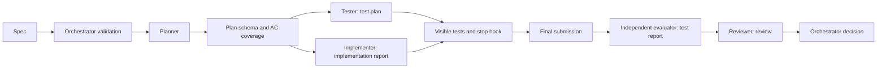

# Week 2 handoff contracts and evaluation

Person B supplies the benchmark, contracts and independent checks. Person A
implements the planner, role agents and hooks. The interfaces below are the
integration proposal in this branch; a passing fixture is not a live team run.

## Decisions and ownership

The orchestrator owns transitions and the accepted plan. Centralizing the
decision avoids roles accepting incompatible outputs or silently relaxing
requirements. It validates every handoff, records rejection reasons, and stops
on an invalid second planner response. The planner gets **one retry** with
validation feedback; this retry policy must be logged and implemented by A.

Planner and reviewer read source only. Tester writes tests in its own area.
Implementer edits source in an isolated worktree and cannot change tests or
push. Each source file has exactly one plan-task owner. If two subtasks need
the same file, the planner groups them into one task. The evaluator independently
checks the submitted diff and runs hidden tests on a fresh checkout.

## Contracts

All six schemas use JSON Schema Draft 2020-12 and reject unknown fields. Input
specs are in `bench/tasks/Txx/spec.json`; `description` preserves the entire
human specification including method signatures. Only spec and target files
go to the model, never `task.json`, reference patches or hidden tests.

| Schema | Required payload | Consumer and failure action |
|---|---|---|
| `spec` | spec_id, description, numbered acs, allowed_paths, budget_usd | Orchestrator rejects malformed input before calling a model. |
| `plan` | spec_id, tasks with id/files/acs, risks | Orchestrator checks all ACs covered, known ACs, unique IDs, allowed files and unique file owners; planner retries once, then stops. |
| `test_plan` | spec_id, test_ids, ac_map | Orchestrator rejects missing ACs, unknown or unmapped tests before test generation. |
| `implementation_report` | spec_id, task_id, per-file diff_stat, notes | Orchestrator checks task and file ownership against the accepted plan, then compares the claim with the actual diff. |
| `test_report` | spec_id, f2p and p2p pass/fail counts, lint | Orchestrator checks evaluator-owned expected counts; failed tests block success. Collection errors are execution errors, never zero-test successes. |
| `review` | spec_id, verdict, findings with file/line/ac/severity/message | Orchestrator rejects invalid references and approval with error findings. Only verified tests and review together can permit the next stage. |

`contracts.validate_contract(kind, data, spec=spec, plan=plan,
expected_counts={"f2p": ..., "p2p": ...})` raises `ContractError` on failure.
`contracts.load_json(path)` rejects duplicate keys and nonstandard constants.
No validation error is silently repaired. Schema validity is necessary but
does not prove an implementation is correct or that a model generated a plan.

The per-spec $1 budget is a configurable proposed ceiling, not a measured cost
or permission to spend. A must enforce total usage and retry limits outside the
container. Relative-path validation is a handoff check, not an OS security
boundary: worktree isolation, diff verification and sandbox restrictions remain
necessary, including for symlinks and indirect shell writes.

## How A integrates B's checks

1. Load the selected `spec.json` and validate it. Feed its complete description
   and ACs to the planner.
2. Validate the plan with spec context. On rejection, retry once with the error;
   log both responses and stop if the second is invalid. Save the accepted plan
   as `runs/week2/plans/Txx.json` without a wrapper.
3. Check saved outputs with `python bench/check_plans.py bench/tasks
   runs/week2/plans --report runs/week2/plan-check.json`. It exits nonzero for
   missing, malformed or incompletely covered plans. Do not supply synthetic
   fixtures as completion evidence.
4. Wire and test real hooks. The controlled probe accepts Python hook scripts:
   `python bench/check_hooks.py --pre-tool-hook PATH --stop-hook PATH --report
   runs/week2/hook-check.json`. The proposed stop-hook report location is
   `<cwd>/.pipeline/visible-test-report.json`, written by a trusted visible-test
   runner, with `exit_code`, `passed` and `failed` counts. Adapt the probe
   and hook together if A chooses a different report location or command type.
5. Save the ten actual planner outputs, retry traces, configured role/hook
   files and five original-task team transcripts. B can then check the artifacts
   and record actual integration results.

Hidden grading runs only after final submission; its test report never feeds
an agent repair loop. The stop hook uses only visible tests. A must prevent the
implementer from forging the trusted report and check that it belongs to the
current source revision; a missing, stale or errored run cannot prove success.

The probe sends eight PreToolUse cases (test edit/write/shell write and push
denials, plus source-edit/read/test-run controls) and two Stop cases (tests fail
vs pass). It executes the supplied trusted hook scripts, **never the proposed
tool commands**. Script hashes and decisions are recorded. These cases do not
prove exhaustive shell protection or live hook registration. A must also show
an implementer attempting to edit a test in a real Claude Code session and
document bounded stop-loop behavior. The probe currently checks fresh pass/fail
reports; stale-report handling and live-session wiring need integration tests.

Reference semantics: [JSON Schema validation](https://json-schema.org/draft/2020-12/json-schema-validation)
and [Claude Code hook input/output](https://code.claude.com/docs/en/hooks#hook-input-and-output).

## Benchmark and evidence boundaries

T01–T05 remain the frozen Week 1 tasks. T06–T10 are independent additions using
the same committed target tree. T06 modifies models/store, T07 models/store,
and T08 storage/public exports in their reference patches. The target library
itself keeps all benchmark features absent.

The Week 1 aggregate intentionally accepts only the five original official
batches. A command targeting all of `bench/tasks` now selects **10 tasks**;
with `--n 3` that is 30 attempts. Do not overwrite row 0 or compare a ten-task
result directly with its five-task 80% rate. Compare matched task sets, commit,
model, limits and repetitions. No new model calls were made for this B delivery.
